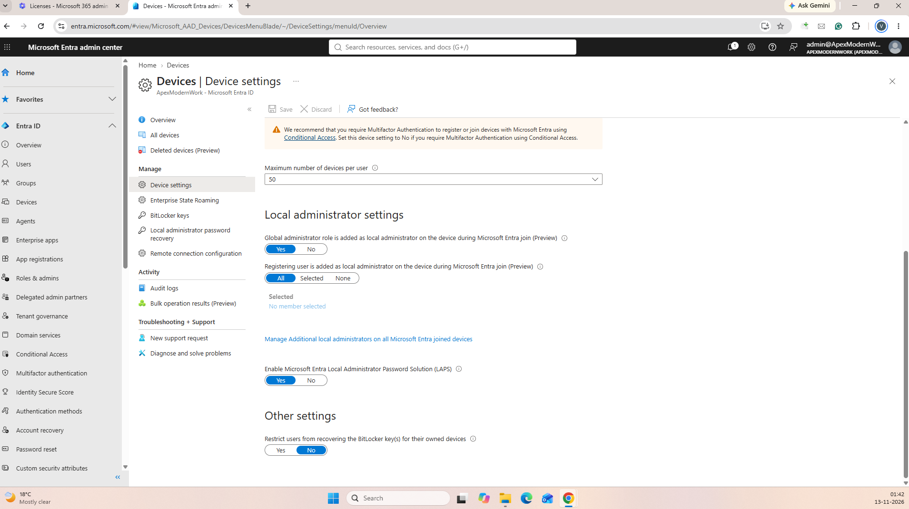
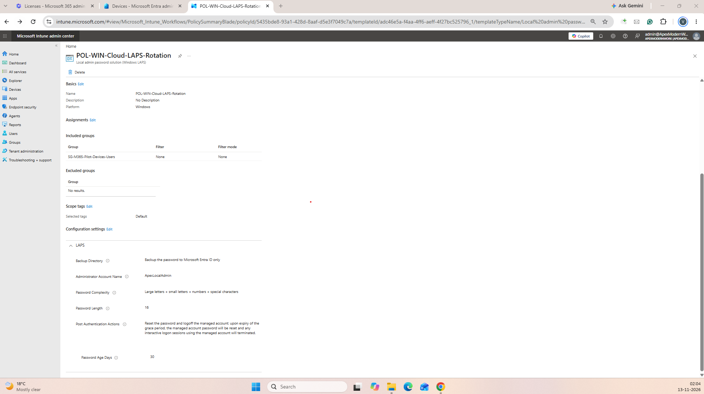
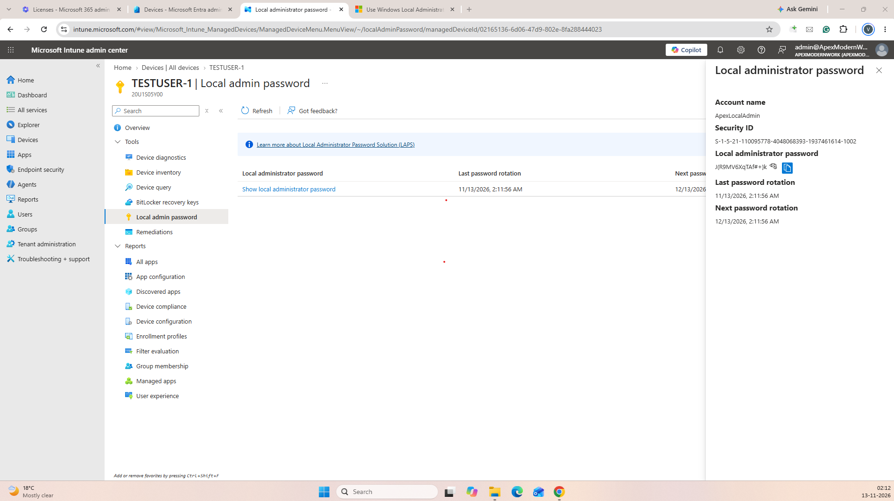
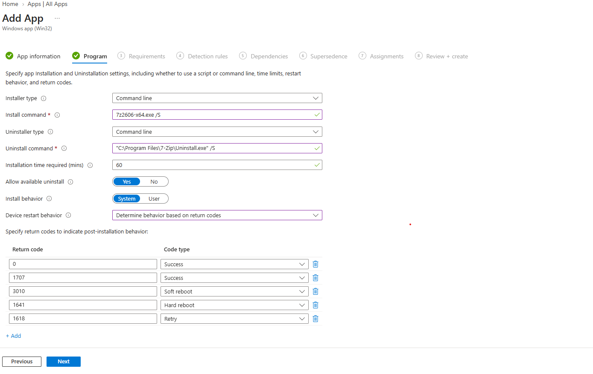
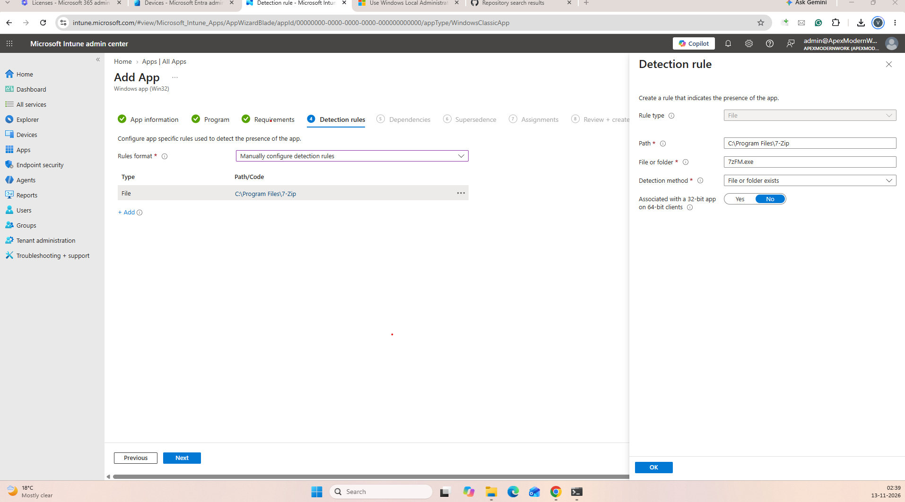
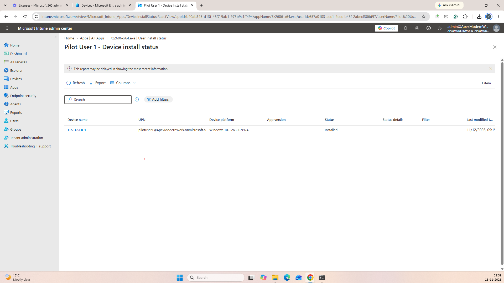
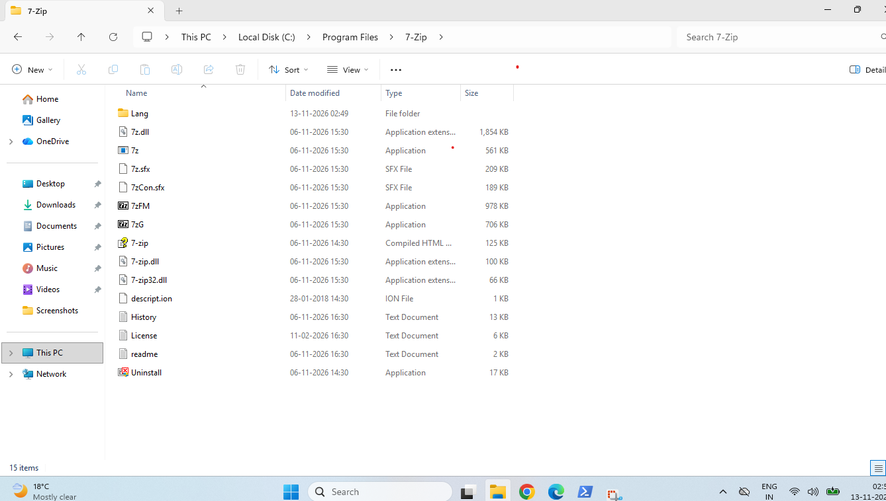

# Cloud-Managed Windows LAPS & Intune Win32 Application Deployment

## Executive Summary
This enterprise endpoint administration lab demonstrates two foundational Microsoft Intune security and software lifecycle workflows on a cloud-joined Windows 11 Pro workstation (`TESTUSER-1`) within the `ApexModernWork.onmicrosoft.com` tenant:
1. **Cloud-Managed Windows LAPS (Local Administrator Password Solution):** Eliminating shared local administrator credentials by enabling Microsoft Entra ID LAPS, deploying an Intune Account Protection rotation policy (`POL-WIN-Cloud-LAPS-Rotation`), and escrowing 16-character rotating passwords directly into Entra ID.
2. **Intune Win32 Application Packaging & Silent Deployment:** Wrapping a native Windows x64 executable (`7z2606-x64.exe`) into an encrypted `.intunewin` package via the Microsoft Win32 Content Prep Tool (`IntuneWinAppUtil.exe`), configuring silent `/S` system-context installation and file-existence detection rules, and validating automated endpoint delivery.

---

## Architecture & Lab Environment
* **Tenant Domain:** `ApexModernWork.onmicrosoft.com`
* **Target Pilot Group:** `SG-M365-Pilot-Devices-Users`
* **Managed Endpoint:** `TESTUSER-1` (`Windows 11 Pro`, Build `26300.9974`, Entra ID Joined & Intune MDM Enrolled)
* **Primary Pilot User:** `pilotuser1@ApexModernWork.onmicrosoft.com`
* **Managed Local Admin Account:** `ApexLocalAdmin`
* **Packaged Application:** `7-Zip 26.06 (x64)` (`7z2606-x64.intunewin`)

---

## Phase 1: Cloud-Managed Windows LAPS Implementation

### 1. Directory-Level Enablement in Microsoft Entra ID
Enabled Microsoft Entra Local Administrator Password Solution (LAPS) under **Entra ID > Devices > Device settings** to authorize cloud key escrow for Entra-joined endpoints.

### 2. Intune Account Protection Policy (`POL-WIN-Cloud-LAPS-Rotation`)
Created and assigned `POL-WIN-Cloud-LAPS-Rotation` to `SG-M365-Pilot-Devices-Users` with the following security baseline:
* **Backup Directory:** Microsoft Entra ID only
* **Administrator Account Name:** `ApexLocalAdmin`
* **Password Age:** 30 days
* **Complexity & Length:** Uppercase, lowercase, numeric, and special characters (16 characters)
* **Post-Authentication Action:** Reset password and log off managed account upon grace period expiration

### 3. Password Rotation & Cloud Escrow Verification
Triggered an MDM policy sync on `TESTUSER-1` and confirmed that Intune rotated the local `ApexLocalAdmin` credential, escrowed the 16-character password to Entra ID, and scheduled the next 30-day rotation cycle.

---

## Phase 2: Intune Win32 Application Packaging & Deployment

### 4. Compiling `.intunewin` Package via `IntuneWinAppUtil.exe`
Used the Microsoft Win32 Content Prep Tool (`IntuneWinAppUtil.exe`) to compress, SHA-256 hash, and encrypt `7z2606-x64.exe` into `7z2606-x64.intunewin`.

### 5. Silent Install/Uninstall Program Configuration
Configured the Win32 application in Microsoft Intune to execute unattended under the `System` context:
* **Install Command:** `7z2606-x64.exe /S`
* **Uninstall Command:** `"C:\Program Files\7-Zip\Uninstall.exe" /S`
* **Install Behavior:** `System`
* **Architecture & OS Requirement:** `64-bit` | `Windows 10 1607` minimum

### 6. Custom File Detection Rule
Defined a manual file-existence detection rule to validate installation integrity on target endpoints:
* **Rule Type:** `File`
* **Path:** `C:\Program Files\7-Zip`
* **File or Folder:** `7zFM.exe`
* **Detection Method:** `File or folder exists`

---

## Phase 3: End-to-End Endpoint Verification

### 7. Intune Device Install Status Reporting
Assigned the Win32 package as **Required** to `SG-M365-Pilot-Devices-Users` and confirmed `TESTUSER-1` reported **Installed** in Microsoft Intune.

### 8. Local Endpoint Application Verification (`TESTUSER-1`)
Verified silent installation directly on `TESTUSER-1`, confirming all 7-Zip binaries (`7zFM.exe`, `7z.exe`, `7zG.exe`, and `Uninstall.exe`) were deployed cleanly to `C:\Program Files\7-Zip`.

---

## Key Operational Takeaways
* **Eliminating Static Local Admin Credentials:** Pairing a dedicated local admin (`ApexLocalAdmin`) with Entra ID-backed LAPS removes lateral-movement risks from shared local passwords without requiring on-premises Active Directory infrastructure.
* **Deterministic Win32 Lifecycle Management:** Wrapping standard installers into `.intunewin` packages with explicit silent switches (`/S`) and binary detection rules (`7zFM.exe`) ensures zero-touch software provisioning and accurate compliance reporting across remote endpoints.
